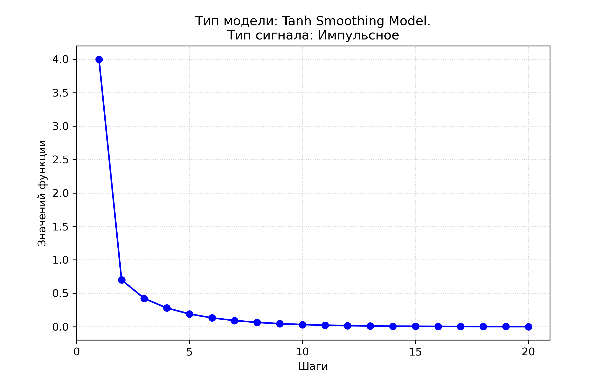

<p align="center">Министерство образования Республики Беларусь</p>
<p align="center">Учреждение образования</p>
<p align="center">“Брестский Государственный технический университет”</p>
<p align="center">Кафедра ИИТ</p>


<br><br><br><br><br><br>


<p align="center">Лабораторная работа №1</p>
<p align="center">По дисциплине “Теория и моделирование автоматического управления”</p>
<p align="center">Тема: “Моделирование объектов управления”</p>
 


<br><br><br><br><br>


<p align="right">Выполнил:</p>
<p align="right">Студент 3 курса</p>
<p align="right">Группы АС-67</p>
<p align="right">Сеглюк К-О.</p>
<p align="right">Проверил:</p>
<p align="right">Дворанинович Д. А.</p>

<br><br><br><br><br>

<p align="center">Брест 2026</p>

---

## Вариант 8

* Обобщенная авторегрессионная линейная модель: **model1-8**
* Модель с гиперболическим сглаживанием: **model2-10**
* Дифференциальная модель постоянного воздействия: **model3-2**

## Математическое описание моделей

### model1-8 (AR Linear Model)
$$y(t+1) = a_1 \cdot y(t) + a_2 \cdot y(t-1) + b_1 \cdot u(t) + b_2 \cdot u(t-1)$$

### model2-10 (Tanh Smoothing Model)
$$y(t+1) = a \cdot \tanh(y(t)) + b \cdot u(t)^3$$

### model3-2 (Integrator Model)
$$y(t+1) = y(t) + dt \cdot (b \cdot u(t))$$

## Исследуемые входные воздействия $u(\tau)$

1. **Ступенчатое**: $u(\tau) = A$
2. **Импульсное**: $u(1) = A, \quad u(\tau > 1) = 0$
3. **Гармоническое**: $u(\tau) = A \cdot \sin(\tau)$

## Архитектура программы (ООП)

В основе программы лежит абстрактный класс `Model`, определяющий единый интерфейс расчёта следующего шага симуляции (`calculateStep`). 
От абстрактного класса наследуются конкретные классы моделей:
* `ArModel`
* `TanhModel`
* `IntegratorModel`

```mermaid
classDiagram
    class Model {
        <<abstract>>
        #alpha double
        #label string
        +calculateStep(uc, up1, up2) double
        +reset() void
        +setInitial(y0) void
        +getName() string
    }
    class ArModel {
        -a1 double
        -a2 double
        -b1 double
        -b2 double
        -prevY1 double
        -prevY2 double
        +calculateStep(...) double
    }
    class TanhModel {
        -gain_k double
        -prevY double
        +calculateStep(...) double
    }
    class IntegratorModel {
        -step_gain double
        -currentY double
        +calculateStep(...) double
    }
    Model <|-- ArModel
    Model <|-- TanhModel
    Model <|-- IntegratorModel

## 4. Результаты моделирования

### Model 1.8 — Generalized Autoregressive Linear Model


### Model 2.10 — Hyperbolic Tangent Smoothing



### Model 3.2 — Pure Constant Input Drive


